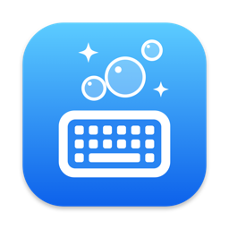

<p align="center">
  
</p>

<h1 align="center">Waschanlagenmodus</h1>

<p align="center"><em>German for “car wash mode” – for your MacBook keyboard.</em></p>

A tiny macOS menu bar app that locks your keyboard so you can wipe it clean without typing gibberish, changing the volume or launching apps. That's all it does.

- 🫧 One click in the menu bar to lock, one click to unlock
- ⏱️ Automatically unlocks after 2 minutes, just in case
- 🔇 Blocks every key, including brightness, volume and media keys
- 🪶 About 500 KB, no Dock icon, zero CPU usage while idle
- 🌍 English and German

## Install

1. Download `Waschanlagenmodus.zip` from the [latest release](../../releases/latest) and move the app to `/Applications`.
2. The app isn't notarized, so macOS blocks it the first time you open it. Open **System Settings → Privacy & Security** and click **Open Anyway**. Or run:
   ```sh
   xattr -dr com.apple.quarantine /Applications/Waschanlagenmodus.app
   ```
3. Start the app. A keyboard icon appears in the menu bar.

## Usage

1. Click the keyboard icon → **Start Car Wash Mode**.
2. The first time, macOS asks for **Accessibility** access (System Settings → Privacy & Security → Accessibility). Allow it, then start the mode again. Restart the app if it still doesn't work. After updating to a new version, macOS may forget the permission: remove the app from the Accessibility list and add it again.
3. The icon changes to bubbles 🫧 and the keyboard is locked. Clean away.
4. Use the trackpad or mouse to click the icon → **Stop Car Wash Mode**, or just wait 2 minutes.

To launch the app automatically, add it under **System Settings → General → Login Items**.

## Privacy

Waschanlagenmodus only throws away keyboard events while the mode is on. It never reads, stores or sends which keys you press, and it doesn't connect to the network. The whole app is about 160 lines of Swift, so you can check for yourself: [`KeyboardBlocker.swift`](Waschanlagenmodus/KeyboardBlocker.swift).

## Limitations

- The power button and Touch ID can't be blocked by software.
- Caps Lock is toggled by the keyboard's firmware, so its LED may flip while you clean.
- If a password field is focused somewhere (Secure Input), keystrokes go there instead.
- If the app quits or crashes, the keyboard is unlocked right away.

## Build from source

Requires Xcode 16 or later and macOS 14 or later.

```sh
xcodebuild -project Waschanlagenmodus.xcodeproj -scheme Waschanlagenmodus \
  -configuration Release -derivedDataPath build build
open build/Build/Products/Release/Waschanlagenmodus.app
```

The Xcode project is generated from `project.yml` with [XcodeGen](https://github.com/yonaskolb/XcodeGen). Run `xcodegen generate` after editing it. The app icon is rendered by `swift Scripts/render-icon.swift icon.png`.

Local builds are ad-hoc signed, so macOS may forget the Accessibility permission after a rebuild. If that happens, remove the app from the Accessibility list and add it again. If you sign with your own Apple Developer team (`CODE_SIGN_STYLE: Automatic` + `DEVELOPMENT_TEAM` in `project.yml`), the permission survives rebuilds.

## License

[MIT](LICENSE) © 2026 Dominic Vogl
